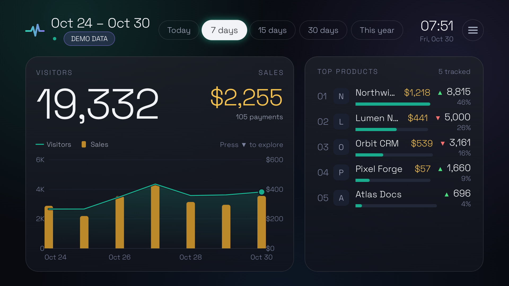

# Pulse TV

Pulse TV is an Android TV app that shows the visitors and sales of your [DataFast](https://datafa.st) websites on the TV, for people who track their products in DataFast and want to keep an eye on them from the couch. Status: sideload only; there are no prebuilt APKs, so you build and install it yourself.



## What it does

- Shows a traffic dashboard with total visitors and sales across every website in your DataFast account.
- Draws a visitors-over-time chart, with sales as bars, for Today, 7 days, 15 days, 30 days or This year.
- Ranks your products by visitors or by sales, with what each one sold and whether its visitors went up or down. Products are listed by their DataFast name, or by domain when a website has no name.
- Runs on clearly labelled demo data when no DataFast token is set.
- Speaks English, Spanish, French, German, Italian, Japanese, Simplified Chinese and Korean.

Runs on Android TV 9 (API 28) or later, Google TV included, and on Fire TV with Fire OS 7 or later.
Built with Kotlin and Compose for TV, and tested on a Fire TV Stick Lite.

## What it is not

- Not a prebuilt download: the DataFast token is compiled into the app, so everyone builds their own APK (see the [Security note](#security-note)).
- Not for Fire TV models on Vega OS, starting with the Fire TV Stick 4K Select: they can't install Android apps, so Pulse doesn't run on them.

## Requirements

- A JDK. Android Studio's bundled JDK works, and CI builds with Temurin 25 (`.github/workflows/ci.yml`).
- The Android SDK with the API 37 platform (`compileSdk` in `app/build.gradle.kts`), from Android Studio or the command-line tools. Point Gradle at it with `ANDROID_HOME` or with `sdk.dir` in `local.properties`.
- `adb`, from the Android SDK platform-tools, and a TV on the same network with ADB debugging on.
- Gradle comes with the wrapper (`./gradlew`); its version is pinned in `gradle/wrapper/gradle-wrapper.properties`.
- Optional: a DataFast account and a read-only account token (see [Configuration](#configuration)). Without one the app runs on demo data.

## Quick start

1. Clone the repository and enter it:

   ```sh
   git clone https://github.com/marcoETmx/pulse-tv.git
   cd pulse-tv
   ```

2. Optional: add your DataFast token to `local.properties` (see [Configuration](#configuration)).

3. Turn on ADB debugging on the TV:

   - **Fire TV**: Settings → My Fire TV → Developer options → **ADB debugging**. ADB listens on port 5555.
   - **Android TV and Google TV**: press the build number seven times in Settings → System → About
     (Device Preferences → About on older Android TV) to show Developer options, and turn on debugging
     there. Menu names and how ADB connects over the network vary by device and Android version; see
     [Connect to a device over Wi-Fi](https://developer.android.com/tools/adb#connect-to-a-device-over-wi-fi).

4. Connect to the TV and install the release build:

   ```sh
   adb connect <tv-ip>:<port>
   ./gradlew installRelease
   ```

Expected result: **Pulse** appears among the TV's apps (*Your Apps & Channels* on Fire TV) and opens
on **7 days**. Without a token, a **DEMO DATA** badge shows in the header.

The release build is minified with R8 (about 1.6 MB, cold start around 2.6 s on a Fire TV Stick Lite)
and signed with the local debug key, because it is meant for sideloading only.

## Usage

| Remote | Action |
|---|---|
| ◀ ▶ on the top row | Move between Today, 7 days, 15 days, 30 days and This year |
| OK | Load the focused period |
| ▼ | Focus the chart |
| ◀ ▶ on the chart | Move a cursor through the hours, days or weeks, with exact visitors and sales |
| ▶ at the end of the chart | Enter the product ranking (first row, or the last one you focused) |
| ▲ ▼ in the ranking | Move one product at a time; the header shows which rows are on screen |
| ▲ | Back to the period selector |
| ☰ | Open the menu from anywhere |
| ▶ past **This year**, then OK | The header's ☰ button opens the menu too, for remotes without ☰ (Google TV's has none) |

### Menu

The menu slides in from the right over the dimmed dashboard, with the focus on the current refresh
interval. ▲ ▼ move through it, OK picks an option and closes it, and ☰ or Back close it without
changes; the focus then goes back to where it was. Periods are picked on the top row, not in the menu.

- **Auto refresh**: every 5, 10 or 15 minutes, with ✓ on the current one. The choice is kept across
  restarts.
- **Top products**: by visitors, as usual, or by sales, with ✓ on the current one.
  - By sales, the bars (in the sales gold) and percentages show each product's part of the sales, and the title reads "Top by sales".
  - Products that sold the same, nothing included, keep their visitor order.
  - When websites report different currencies, sales can't be compared, so the ranking stays by visitors.
  - The choice is kept across restarts. It only reorders the data on screen, so it costs no DataFast requests.
- **Refresh now**: reloads right away, skipping data loaded minutes ago. It reads "Refreshing…" and
  can't be picked while a load is running.
- **Language**: System default, English, Español, Français, Deutsch, Italiano, 日本語, 简体中文 or 한국어,
  each named in its own language. System default follows the TV's language when Pulse speaks it, and
  English otherwise; Chinese is Simplified, also on a TV set to Traditional Chinese. Numbers and dates
  follow the language too, so Japanese, Chinese and Korean shorten large numbers by 万 or 만. Their
  characters are drawn with the TV's own font, since Space Grotesk has none. The choice is kept
  across restarts, and it sits last, below the fold, since it is picked once.
- At the bottom: where the data comes from (DataFast or demo), the app version, when the data was
  updated, and when the next refresh comes.

Periods, sales, logos, refreshes and how Pulse stays within DataFast's rate limit are described in
[How the dashboard works](docs/dashboard.md).

## Configuration

Pulse reads every website in your account, so it needs a DataFast **account token** (`dft_`),
not a single-website key (`df_`). Create it in DataFast under **Account settings → API** and give it
only these permissions:

- `analytics:read`
- `websites:read`

Then add it to `local.properties`, which is git-ignored:

```properties
DATAFAST_TOKEN=dft_your_token_here
```

| Setting | Where | Required | Description |
|---|---|---|---|
| `DATAFAST_TOKEN` | `local.properties` | No | DataFast account token, compiled into the APK. Without it the app runs on demo data. |
| `sdk.dir` | `local.properties` | `sdk.dir` or `ANDROID_HOME` | Android SDK location. |
| `ANDROID_HOME` | Environment | `sdk.dir` or `ANDROID_HOME` | Android SDK location. |
| `JAVA_HOME` | Environment | When `java` is not on `PATH` | JDK that `./gradlew` runs with. |

Never commit `local.properties` or paste a token in an issue, a pull request or a commit.

## Troubleshooting

| Symptom or exact error | Cause | Fix |
|---|---|---|
| `ERROR: JAVA_HOME is not set and no 'java' command could be found in your PATH.` | `./gradlew` can't find a JDK. | Set `JAVA_HOME` to one, such as the `jbr` folder inside Android Studio's install directory. |

## Architecture

The code under `app/src/main/java/com/marcoelizalde/pulse/` is organized by capability (`traffic`),
with ports and adapters inside it:

```
traffic/
  domain/      Periods, report windows, LoadTrafficDashboard, AnalyticsSource port
  datafast/    DataFast REST adapter (account token, websiteId per request) + rate limiter
  demo/        Deterministic demo source used when no token is set
  logos/       Product logos: DataFast's, else the site's icon; cached on disk
  dashboard/   View model, display formats, and Compose for TV screen and components
    i18n/      One text catalog per language, and the language choice
net/           HTTP transport shared by the DataFast adapter and the logo lookups
ui/theme/      Colors, Space Grotesk typography, theme
```

`MainActivity` is the composition root: it picks the DataFast or demo source and builds the view model.

## Security note

The token is compiled into the APK, so anyone with the APK file can extract it. Keep the APK private,
and use a token limited to `analytics:read,websites:read`. Revoke it in DataFast if the APK leaks.

The Gradle build cache stays off (Gradle's default; `gradle.properties` explains why) so the token
is not copied into `~/.gradle/caches`; keep it that way. The HTTP client never follows redirects on
requests that carry the token, so the token is only ever sent to `datafa.st`.

## Development

- Contribution process, running the tests and adding a language: [CONTRIBUTING.md](CONTRIBUTING.md)
- Working with a coding agent: [AGENTS.md](AGENTS.md)
- Reporting a security problem privately: [SECURITY.md](SECURITY.md)

## Documentation

- [How the dashboard works](docs/dashboard.md): refreshes and retries, the DataFast rate limit, periods, sales and logos.
- [Launcher artwork](docs/launcher-artwork.md): how the icon and banner are rendered, and why the package name matters on Fire TV.

## Credits

Space Grotesk font by the Space Grotesk Project Authors, licensed under the SIL Open Font License 1.1
(`docs/licenses/SpaceGrotesk-OFL.txt`).

## License

Copyright 2026 Marco Elizalde

Licensed under the Apache License, Version 2.0. See [LICENSE](LICENSE).
