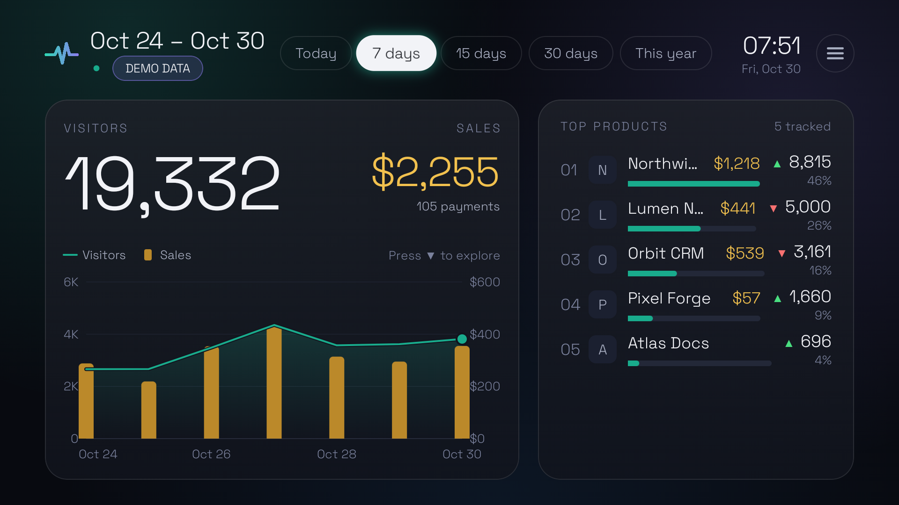

# Pulse TV

An Android TV app for keeping an eye on your products from the couch. The first screen is a
traffic dashboard fed by [DataFast](https://datafa.st): total visitors and sales across every
website in your account, a visitors-over-time chart, and a ranking of your products with what each
one sold and whether its visitors went up or down. Products are listed by their DataFast name, or by
domain when a website has no name.

Runs on Android TV 9 (API 28) or later, Google TV included, and on Fire TV with Fire OS 7 or later.
Fire TV models on Vega OS, starting with the Fire TV Stick 4K Select, can't install Android apps, so
Pulse doesn't run on them. Built with Kotlin and Compose for TV, and tested on a Fire TV Stick Lite.



## Setup

You build Pulse yourself: there are no prebuilt APKs, because the token is compiled into the app
(see the [Security note](#security-note)). You need:

- A JDK. Android Studio's bundled JDK works, and CI builds with Temurin 25.
- The Android SDK, from Android Studio or the command-line tools. Point Gradle at it with
  `ANDROID_HOME` or with `sdk.dir` in `local.properties`.

### 1. Create a read-only DataFast token

Pulse reads every website in your account, so it needs a DataFast **account token** (`dft_`),
not a single-website key (`df_`). Give it only these permissions:

- `analytics:read`
- `websites:read`

Create it in DataFast under **Account settings → API**, or with the DataFast CLI:

```sh
datafast tokens create --name "Pulse TV" --permissions "analytics:read,websites:read"
```

### 2. Add it to `local.properties`

`local.properties` is git-ignored. Add one line:

```properties
DATAFAST_TOKEN=dft_your_token_here
```

Without a token the app runs on clearly labelled **demo data**, which is handy for trying the design.

### 3. Build and install on the TV

Turn on ADB debugging on the TV:

- **Fire TV**: Settings → My Fire TV → Developer options → **ADB debugging**. ADB listens on port 5555.
- **Android TV and Google TV**: press the build number seven times in Settings → System → About
  (Device Preferences → About on older Android TV) to show Developer options, and turn on debugging
  there. Menu names and how ADB connects over the network vary by device and Android version; see
  [Connect to a device over Wi-Fi](https://developer.android.com/tools/adb#connect-to-a-device-over-wi-fi).

Then connect and install:

```sh
adb connect <tv-ip>:<port>
./gradlew installRelease
```

If Gradle can't find a JDK, set `JAVA_HOME` to one, such as the `jbr` folder inside Android Studio's
install directory.

The release build is minified with R8 (about 1.6 MB, cold start around 2.6 s on a Fire TV Stick Lite)
and signed with the local debug key, because it is meant for sideloading only. Open **Pulse** from
the TV's apps (*Your Apps & Channels* on Fire TV).

## Using it with the remote

| Remote | Action |
|---|---|
| ◀ ▶ on the top row | Move between Today, 7 days, 15 days, 30 days and This year |
| OK | Load the focused period |
| ▼ | Focus the chart |
| ◀ ▶ on the chart | Move a cursor through the hours, days or weeks, with exact visitors and sales |
| ▶ at the end of the chart | Enter the product ranking (first row, or the last one you focused) |
| ▲ ▼ in the ranking | Move one product at a time; the header shows which rows are on screen |
| ▲ | Back to the period selector |
| ☰ | Open the menu from anywhere |
| ▶ past **This year**, then OK | The header's ☰ button opens the menu too, for remotes without ☰ (Google TV's has none) |

### Menu

The menu slides in from the right over the dimmed dashboard, with the focus on the current refresh
interval. ▲ ▼ move through it, OK picks an option and closes it, and ☰ or Back close it without
changes; the focus then goes back to where it was. Periods are picked on the top row, not in the menu.

- **Auto refresh**: every 5, 10 or 15 minutes, with ✓ on the current one. The choice is kept across
  restarts.
- **Top products**: by visitors, as usual, or by sales, with ✓ on the current one.
  - By sales, the bars (in the sales gold) and percentages show each product's part of the sales, and the title reads "Top by sales".
  - Products that sold the same, nothing included, keep their visitor order.
  - When websites report different currencies, sales can't be compared, so the ranking stays by visitors.
  - The choice is kept across restarts. It only reorders the data on screen, so it costs no DataFast requests.
- **Refresh now**: reloads right away, skipping data loaded minutes ago. It reads "Refreshing…" and
  can't be picked while a load is running.
- **Language**: System default, English, Español, Français, Deutsch or Italiano, each named in its own
  language. System default follows the TV's language when Pulse speaks it, and English otherwise.
  Numbers and dates follow the language too, and the choice is kept across restarts. It sits last,
  below the fold, since it is picked once.
- At the bottom: where the data comes from (DataFast or demo), the app version, when the data was
  updated, and when the next refresh comes.

The dashboard refreshes every 5 minutes while it is on screen (10 or 15 if you choose so; the choice
is kept across restarts), pauses when you leave the app, and keeps the TV awake while it is open.
Choosing an interval shorter than the age of the data on screen reloads it right away.

A request that fails because of the network or a DataFast server error (5xx) is tried twice more,
after 1 and 3 seconds, before the dashboard reports it. A dashboard is shown only when every website
loaded, because a total with a website missing would be wrong; until then the last one stays on
screen.

### DataFast rate limit

DataFast allows 60 API requests per minute per token. Pulse sends at most 55 in any minute, leaving
room for network delays; requests beyond that wait their turn, so flipping through several periods
makes the last one load more slowly instead of failing.

A dashboard load costs one request per website for the period and one for the previous period. The
previous period is reused for up to 30 minutes (less on short stretches like **Today**, so it stays
within 1% of a fresh comparison), and the website list for an hour. A period you opened within the
refresh interval is shown again without calling DataFast. No interval is shorter than 5 minutes, and
refreshing by hand is ignored while a load is running, so presses never pile up requests.

The budget belongs to the token: every device running Pulse with the same token shares DataFast's 60
requests per minute, and Pulse can't see what the others spend. So if DataFast still answers `429`,
Pulse sends nothing more until DataFast's reset (the next minute, never more than 2 minutes away)
and then retries on its own, keeping the last data on screen. The previous period is asked for last,
so if the limit runs out there, the ranking just shows no arrows. (DataFast's docs give the reset in
seconds, but it arrives in milliseconds; Pulse reads both.)

## Periods

Pulse opens on **7 days**. The header shows the date range of the data on screen and when it
was last updated; on demo data, a **DEMO DATA** badge takes the place of the update time.

- **Today**: midnight to now, in hourly buckets (hours that have not started are not drawn).
- **7, 15, 30 days**: today plus the previous 6, 14 or 29 days, in daily buckets.
- **This year**: January 1 to today. Buckets follow the window length: hourly on January 1,
  daily up to 62 days, weekly after that.

Dates use the TV's timezone.

Each product in the ranking shows a green ▲ or a red ▼ when its visitors went up or down against
the same stretch of the previous period: at 12:30 on **7 days**, that is the 7 days before, up to
12:30. There is no arrow when the number is the same or the previous period could not be loaded.

## Sales

Sales are the revenue and payments DataFast attributes to each website, so a product shows sales
only once its payments are connected in DataFast. They arrive in the same request as the visitors,
so they cost no extra rate-limit budget. Amounts use the currency DataFast reports; when websites
report different currencies the total reads "Mixed currencies", because they cannot be added up.

When the period has sales, the chart draws them as gold bars behind the visitors line, on a money
axis on the right that shares the visitor gridlines. The two axes are scaled independently, so
compare each measure with itself over time, not the height of a bar with the line. The chart
cursor shows both values for each hour, day or week.

## Logos

Each product shows the logo set in DataFast, else the icon its website declares, else its initial.
Logos are kept on the TV for a week, and so is knowing that a product has none. A logo that could not
be fetched because the site or the network failed is tried again with the next refresh.

## Launcher artwork

Fire TV draws sideloaded apps' icons in a square centered on a gray 16:9 tile and squeezes
non-square images, so `ic_launcher.png` is a transparent square with the "Pulse" lockup. The 16:9
`banner.png` is still declared for Android TV / Google TV launchers. Both are rendered by
`tools/RenderBranding.java` (usage in its header).

The Fire TV launcher caches an app's icon per package name and does not refresh it on update,
reinstall or reboot; that is why the package is `com.marcoelizalde.pulse.tv`. Get the artwork right
before installing under a new package name.

## Architecture

The code is organized by capability (`traffic`), with ports and adapters inside it:

```
traffic/
  domain/      Periods, report windows, LoadTrafficDashboard, AnalyticsSource port
  datafast/    DataFast REST adapter (account token, websiteId per request) + rate limiter
  demo/        Deterministic demo source used when no token is set
  logos/       Product logos: DataFast's, else the site's icon; cached on disk
  dashboard/   View model, display formats, and Compose for TV screen and components
    i18n/      One text catalog per language, and the language choice
net/           HTTP transport shared by the DataFast adapter and the logo lookups
ui/theme/      Colors, Space Grotesk typography, theme
```

`MainActivity` is the composition root: it picks the DataFast or demo source and builds the view model.

## Tests

```sh
./gradlew testDebugUnitTest
```

CI runs them and builds the release APK on every push to `main` and every pull request, without a
token.

## Security note

The token is compiled into the APK, so anyone with the APK file can extract it. Keep the APK private,
and use a token limited to `analytics:read,websites:read`. Revoke it in DataFast if the APK leaks.

The Gradle build cache is disabled in `gradle.properties` so the token is not copied into
`~/.gradle/caches`; keep it that way. The HTTP client never follows redirects, so the token is only
ever sent to `datafa.st`.

## Credits

Space Grotesk font by the Space Grotesk Project Authors, licensed under the SIL Open Font License 1.1
(`docs/licenses/SpaceGrotesk-OFL.txt`).

## Contributing

Issues and pull requests are welcome; see [`CONTRIBUTING.md`](CONTRIBUTING.md). Report security
problems privately as described in [`SECURITY.md`](SECURITY.md).

## License

Copyright 2026 Marco Elizalde

Licensed under the Apache License, Version 2.0. See [`LICENSE`](LICENSE).
